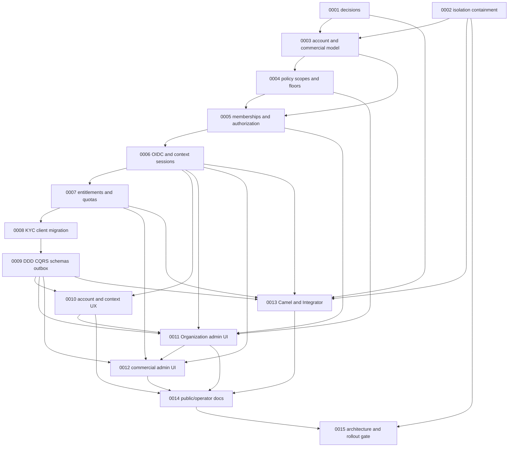

# Account, Organization and CommercialClient roadmap

- **Status:** planning baseline; none of the target capabilities below should be read as implemented.
- **Baseline review:** 2026-10-03.
  **Execution rule:** the briefs in [`tasks/README.md`](tasks/README.md) are the implementation backlog. All are planning-only; do not infer approval or production readiness from their existence.

## Outcome

Move Complyz from a single-Organization `User` model to an enterprise, multi-tenant model with separate personal identity (`Account`), operational tenant (`Organization` / business label “Corporação”), and contract holder (`CommercialClient`). Every compliance operation remains explicitly Organization-scoped. Commercial administration does not grant access to compliance records. Support must be evidenced by API authorization tests, migration rehearsal, browser flows and accurate customer/operator documentation before release.

## Reviewed baseline

The repository review confirmed these current-state facts:

- `User` has one required `Organization`, one global `Role`, and MFA fields; there are no `Account`, `CommercialClient`, or membership entities. `TenantAccessService` resolves only that one Organization. `V18__add_organizations_and_tenant_scope.sql` backfills users, KYC clients and import batches to one default Organization; the current maximum migration version is V24. Existing migrations are immutable.
- Authentication is local password/JWT/refresh/TOTP with symmetric HMAC signing. There is no OIDC/JWKS/BFF session flow. The UI persists access/refresh tokens in `localStorage`.
- The shell's `OrganizationSelector` receives a hard-coded default Organization. The UI has no Account, Organization-membership, effective-policy or commercial-administration workflows.
- `FlagService` lists and loads flags by unscoped IDs; `InsightsService` uses global counts and a single cache key (`'summary'`). `ReportController` has unscoped STR/CTR list, detail, update and submit paths; only export paths shown in the reviewed controller use Organization scoping. `AuditLogController` queries logs globally. `ClientController` lists KYC records without an Organization predicate; `KycController` lists/adds/verifies beneficial owners and recalculates by global IDs. `ImportController` lists/details batches globally (the processing service has a separate ownership/Organization check). User administration calls `findAll()` and filters the user's single Organization in memory. Repository methods that happen to be scoped do not secure unscoped controller/service call paths.
- Prior repository review recorded reproducible A/B cross-tenant findings in beneficiary, report, flag and indicator workflows. Transaction aggregates, jobs, storage and other indirect relationships still need a route-by-route audit; the current single-Organization model is not proof of isolation.
- `ClientType` still contains `INDIVIDUAL` and `CORPORATE`, and the UI mapper defaults KYC records to `INDIVIDUAL`. Public API docs still describe local login/refresh. `docs/guides/organization-and-access.mdx` is minimal. `ROADMAP.md` was empty before this plan.
- The UI API contract tests check route/schema compatibility only when a remote OpenAPI URL is configured; they do not establish tenant-isolation behavior. Existing focused report coverage verifies an annual export's Organization ID, not denial across tenants.

This review is a planning baseline, not a security certification. Task 0002 is a containment gate and Task 0015 must re-audit every customer-data path, including jobs, indirect relations, cache, storage and audit.

## Domain and decision status

### Confirmed requirements

- Complyz is enterprise-only in the target model; an Organization is the tenant and every Organization belongs to exactly one CommercialClient.
- `Account` is the technical name for the human identity; its target name in code and schema is closed. Existing `User` data must be preserved when migrated.
- Organization memberships, rather than the Account itself, carry Organization role and status. Account profile/security, Organization compliance operations and CommercialClient administration are separate permission domains.
- A CommercialClient is a contract holder and groups Organizations; it must not read compliance data merely by virtue of that relationship. KYC `Client` and OAuth client are distinct concepts. Avoid the unqualified word “client” in code, APIs and docs.
- All compliance reads, writes, aggregates, exports, caches, stored files, background jobs and audit queries must derive and enforce the authorized Organization context on the server.
- Flyway is append-only. Do not merge existing Organizations automatically or silently convert KYC people to corporate entities.

### Approval gate — proposals are not approved product policy

Several decisions are marked as proposed, and the model overview treats cross-CommercialClient membership as undecided while the detailed Account-membership decision permits it. Task [0001](tasks/0001-ratify-account-organization-decisions.md) must record an explicit approval or revision before dependent implementation proceeds. Resolve, at minimum:

1. Whether cross-CommercialClient Account membership is permitted, and the precise external-member invitation/domain/expiry/consent policy.
2. Commercial `PolicyFloor` key allow-list, monotonic comparison semantics, enforcement latency, preview, notification and audit requirements.
3. The final role matrix, exclusive read-only behavior, last-`OWNER` invariant, transfer acceptance/step-up and regulatory maker-checker approver matrix.
4. Entitlement/module and quota defaults, per-Organization allocation behavior, what is quota-limited, alert recipients and contract/billing behavior.
5. WSO2 Identity Server 7.3 self-hosted versus Asgardeo deployment, initial session lifetimes, revocation behavior, IdP ownership/residency and operational responsibilities.
6. Whether to approve each target architecture proposal (DDD contexts, CQRS-light, AJV/JSON Schema, Apache Camel, and WSO2 Integrator boundary) and the conditions for enabling optional external mediation.

The target's Account name, tenant semantics and separation of commercial/operational access are not open for silent redesign. If approval changes a proposed item, amend the decision record, roadmap and affected brief before implementation.

## Dependency-aware phases

No calendar estimates are included: team capacity, commercial decisions and IdP/Integrator operating environments have not been confirmed. Tasks must execute in dependency order; where shared API-contract, migration, shell or test files overlap, work is serial, not concurrent.

| Phase                                          | Purpose and release gate                                                                                                                                                                    | Tasks                                                                                                                                                                                                  |
| ---------------------------------------------- | ------------------------------------------------------------------------------------------------------------------------------------------------------------------------------------------- | ------------------------------------------------------------------------------------------------------------------------------------------------------------------------------------------------------ |
| 0. Decide and contain                          | Approve unresolved product/security/architecture decisions; immediately close known single-tenant exposure paths and prove A/B denial. No new multi-tenant release before both gates.       | [0001](tasks/0001-ratify-account-organization-decisions.md), [0002](tasks/0002-contain-cross-organization-access.md)                                                                                   |
| 1. Establish identity and commercial tenancy   | Add Account/membership/CommercialClient persistence with deterministic backfill, then explicit policy scopes and membership authorization.                                                  | [0003](tasks/0003-account-commercial-client-persistence.md), [0004](tasks/0004-explicit-policy-scopes-and-security-floors.md), [0005](tasks/0005-membership-authorization-and-separation-of-duties.md) |
| 2. Secure sessions and enforce contract limits | Federate authentication and issue server-authorized context tokens; implement commercial entitlements/quotas and resolve KYC `INDIVIDUAL` without losing person records.                    | [0006](tasks/0006-oidc-context-tokens-and-session-revocation.md), [0007](tasks/0007-commercial-entitlements-and-quotas.md), [0008](tasks/0008-kyc-client-types-and-individual-migration.md)            |
| 3. Formalize architecture and integrations     | Add bounded-context guardrails, lightweight CQRS, shared versioned schemas and transactional outbox; implement internal jobs and only the external adapters required by approved use cases. | [0009](tasks/0009-ddd-cqrs-schemas-and-outbox.md), [0013](tasks/0013-camel-jobs-and-wso2-integrator.md)                                                                                                |
| 4. Deliver customer workflows                  | Implement Account/context UX, Organization member/policy settings and isolated commercial administration with real APIs and accessible operational states.                                  | [0010](tasks/0010-account-and-organization-context-ux.md), [0011](tasks/0011-organization-members-policy-and-settings-ui.md), [0012](tasks/0012-commercial-administration-ui.md)                       |
| 5. Explain and prove the release               | Publish only implemented/tested behavior; pass the complete architecture, tenant-isolation, migration, security, contract, accessibility and recovery gates.                                | [0014](tasks/0014-public-docs-and-operator-guides.md), [0015](tasks/0015-architecture-acceptance-and-rollout-gates.md)                                                                                 |

### Dependency graph



The graph is a readable critical-path view, not an exhaustive edge list. Exact direct dependencies are in the index table and each brief's front matter; shared migration, generated API contract, auth/UI and test scopes remain serialized even where the diagram has no edge.

## Requirement-to-task coverage matrix

Every target section and acceptance criterion is mapped below. The named brief is authoritative for implementation scope and checks.

| Target criteria                                  | Required outcomes                                                                                                                                                                                                                                       | Task coverage                            |
| ------------------------------------------------ | ------------------------------------------------------------------------------------------------------------------------------------------------------------------------------------------------------------------------------------------------------- | ---------------------------------------- |
| Domain vocabulary and relationships              | `Account`, `Organization`, `OrganizationMembership`, `CommercialClient`, CommercialClient/Organization cardinality, multiple memberships subject to approval, external users, no ambiguous “client”, Account without membership limited to self-service | 0001, 0003, 0005, 0006, 0014             |
| KYC person/corporate classification              | Enterprise target excludes it; classify legacy records without converting persons to companies; keep KYC `Client`, Account and Organization separate; make KYC-Organization relationship explicit                                                       | 0008, 0014, 0015                         |
| Operational and commercial authorization context | `(account_id, organization_id)` operational context; derive CommercialClient server-side; missing Organization fails closed; no implicit access by selection or same CommercialClient; separated commercial route/permission                            | 0002, 0005, 0006, 0007, 0010, 0012, 0015 |
| Token classes and session lifecycle              | IdP profile identity; five-minute operational and commercial `at+jwt`; claims, context issuance, membership/policy validation, explicit switch; authorization version in Redis, `jti` deny-list, back-channel logout ≤60 seconds                        | 0006, 0015                               |
| Role model and authorization tests               | Organization and CommercialClient role matrices; no Account roles; platform/support identity separate; allow/deny tests at each boundary                                                                                                                | 0001, 0005, 0015                         |
| Account profile and security configuration       | Personal profile, language/timezone/notification preferences, MFA factors/recovery, linked external identities and active sessions; sensitive actions step-up/audit                                                                                     | 0006, 0010                               |
| Organization configuration                       | Enterprise profile, members/roles, compliance rules/thresholds, authentication/session/SSO requirements, integrations, notifications/modules; explicit persisted provenance, preview/audit on propagation                                               | 0004, 0005, 0011, 0013                   |
| CommercialClient configuration                   | Contract, entitlements, quotas, billing, commercial contacts, templates and security floors without compliance data access                                                                                                                              | 0004, 0007, 0012                         |
| Policy provenance and floor semantics            | No silent inheritance; template by copy with `template:<id>@<version>` provenance; explicit preview/propagation; monotonic floors with `floor:commercial_client`; effective value/origin/editor visible                                                 | 0004, 0011, 0012                         |
| OIDC, OAuth2, JWT and JWKS                       | WSO2 IS 7.3 deployment decision; OAuth clients/scopes; client credentials for integrations; exact issuer/audience/algorithm/token type; key rotation, unknown `kid` refresh throttle, reject unsafe headers/algorithms; publish API JWKS                | 0001, 0006, 0013, 0015                   |
| PKCE and BFF security                            | Authorization Code + S256, exact redirects, `state`, `nonce`, response issuer validation, no implicit/password grants, server-held IdP/refresh tokens, secure cookie and CSRF controls, rotation/reuse detection                                        | 0006, 0010, 0015                         |
| Step-up and MFA                                  | Validate `acr`, `amr`, `auth_time`; RFC 9470 challenge; TOTP and recovery controls; enforce Organization requirements rather than trusting login alone                                                                                                  | 0004, 0006, 0015                         |
| Baseline architecture gaps                       | Commercial parent/membership model, local auth migration, policy scopes, all tenant failures, KYC semantics                                                                                                                                             | 0002–0009, 0015                          |
| Implementation sequence and acceptance           | Deterministic backfill; all data-bearing paths scoped; UI capabilities; two-CommercialClient/multi-Organization scenarios; session, policy, quota, jobs/export and maker-checker scenarios; docs claim only proven behavior                             | 0002–0015, especially 0015               |
| Commercial security floors                       | Closed key allow-list; monotonic stricter-only behavior; step-up, affected-Organization preview, audit/notifications, immediate auth-version effect                                                                                                     | 0001, 0004, 0006, 0011, 0012, 0015       |
| Roles and separation of duties                   | Owner/admin powers, compliance role combination, exclusive auditor, last owner, accepted/step-up transfer, notifications, distinct preparer/approver, commercial/operational separation                                                                 | 0001, 0005, 0006, 0011, 0015             |
| Modules, entitlements and quotas                 | Commercial entitlements and term; explicit Organization allocation/default; transactional command-side counters; preserve required regulatory read/report/export/retention/audit; 80%/100% alerts                                                       | 0001, 0007, 0012, 0015                   |
| Identity provider and revocation                 | Provider/hosting decision; 5-minute context tokens; initial 30-minute idle/8-hour absolute session settings subject to approved floors; per-request Redis version, deny-list, 60-second back-channel logout                                             | 0001, 0006, 0015                         |
| Cross-CommercialClient Account membership        | Explicit approval of policy conflict; invitation/e-mail verification, no self-join, external flag/MFA/expiry/renewal/default-off policy, context-specific enforcement, consolidated view restriction and external-access history                        | 0001, 0005, 0010, 0011, 0015             |
| DDD bounded contexts                             | Identity & Access, Tenancy & Commercial, Policy and Compliance contexts; `OrganizationAccess`/`CommercialClient` aggregate invariants; ArchUnit dependency tests                                                                                        | 0003, 0005, 0009, 0015                   |
| CQRS and transactional outbox                    | Lightweight command/query separation without event sourcing; transactional quota/invariant enforcement; authorized read models; domain events and auth-version increment in same transaction                                                            | 0005, 0007, 0009, 0013, 0015             |
| Versioned JSON Schema and AJV                    | New versioned `packages/contracts`; strict AJV and compiled schemas; Java validation of same schemas; schema versions, canonical ingestion and token claims; no external-input schema compilation                                                       | 0009, 0013, 0015                         |
| Camel and WSO2 Integrator boundary               | Camel internal outbox/ingest/sanctions/export jobs with idempotency, DLQ and backoff; WSO2 Integrator only for required external mediation; per-Organization/integration client credentials and least scopes; IdP remains separate                      | 0001, 0006, 0009, 0013, 0015             |
| UI and product language                          | Real organization selector, context/cache clearing, profile/security, member/role/policy and commercial flows; accessible honest states, operational density, direct `pt-MZ`                                                                            | 0010–0012, 0014, 0015                    |
| Documentation and release proof                  | Mintlify navigation; guide Account → Organizations → permissions → policies → authentication → CommercialClient → compliance → API; identify proposed vs implemented/tested state and release evidence                                                  | 0001, 0014, 0015                         |

## Release gates and validation

No release is complete until all applicable gates pass:

1. **Decision gate:** task 0001 records approvals/revisions for every proposed decision and resolves the multi-CommercialClient membership inconsistency. No ambiguous policy is encoded as a default.
2. **Isolation gate:** task 0002 closes known access paths; task 0015 runs cross-tenant negative tests for direct, indirect, list, aggregate, export, cache, audit and asynchronous flows across C1/A1/A2 and C2/B1. Request-supplied IDs and same-commercial membership alone never grant access.
3. **Data gate:** append-only migrations are rehearsed on a production-like copy; row counts, foreign keys, memberships, role mapping, KYC classifications and no-merge guarantees are checked; repeatability, backup, recovery and rollback/forward-fix are documented. Never rewrite already-applied migrations.
4. **Identity gate:** OIDC/BFF and token validation tests cover PKCE, state/nonce/issuer, JWKS rotation/unknown keys, wrong `iss`/`aud`/`typ`/algorithm, step-up evidence, refresh reuse, membership/policy version revocation and back-channel logout latency.
5. **Authorization gate:** role allow/deny matrix, last owner, exclusive auditor, accepted ownership transfer, commercial/compliance separation, external membership, maker-checker and quota-exhaustion exemptions pass.
6. **Contract and architecture gate:** Spring routes, OpenAPI, generated `packages/api-clients`, typed UI client, versioned JSON schemas and tests agree; ArchUnit/boundary tests pass; outbox handlers are idempotent and observable.
7. **Experience/documentation gate:** UI context changes clear all relevant client caches and show accessible loading/empty/error/denied states. Product language check passes. Mintlify and README distinguish target, implemented, and verified functionality.

Repository commands to run from the root, as relevant to each task and at the final gate:

```bash
pnpm api:test
pnpm check
pnpm test:unit
pnpm test:contract
pnpm product-language:check
pnpm operations:test
pnpm compose:config
```

`pnpm test:contract` may skip its OpenAPI-backed assertion when `COMPLYZ_OPENAPI_URL` is unset; the release gate must run it against the candidate API and retain the result. Run the relevant Playwright E2E projects for context switching, role denial and customer flows when the browser/runtime is available. A green build is not evidence of tenant isolation.

## Definition of done

- Every requirement in the coverage matrix maps to a completed task, an approved explicit deferral, or a documented product decision; no target feature is represented as shipped before tests/evidence exist.
- Every data-access path takes trusted server context; all background work and secondary systems carry Organization identity; commercial reads cannot cross into compliance data implicitly.
- Data migration, incident response, revocation, quota exhaustion and recovery are observable and operationally documented.
- Product, security, compliance and architecture owners have approved the relevant decision record and release gate evidence.
