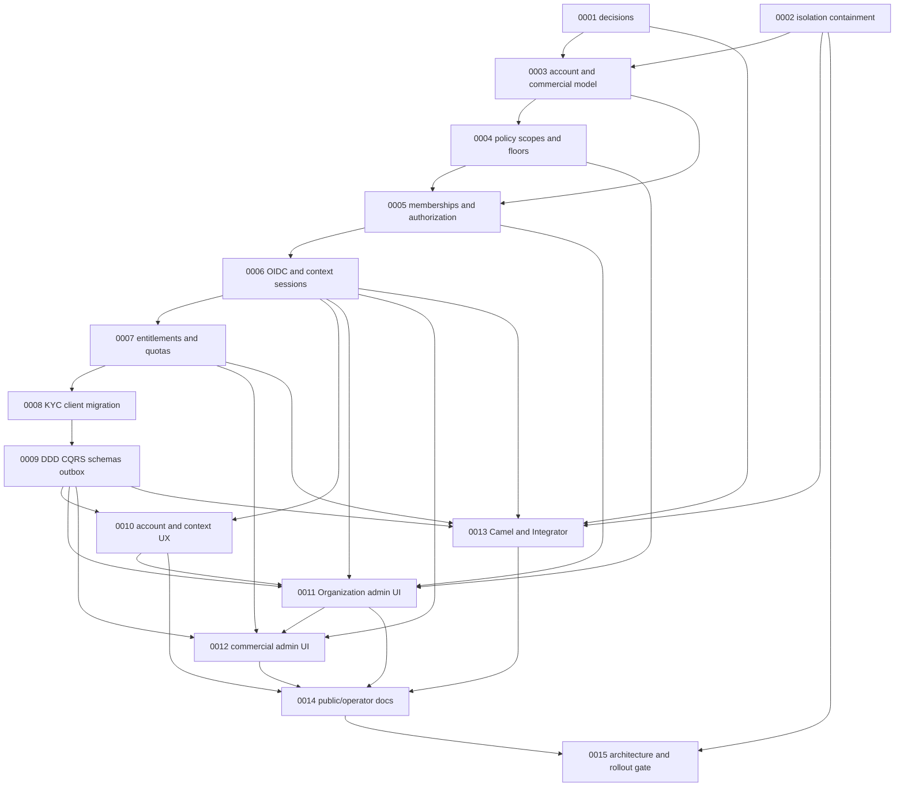

# Account, Organization and CommercialClient roadmap

- **Status:** decisions ratified; implementation remains planning-only unless verified by code and tests. Approval closes task 0001, not implementation or release gates.
- **Baseline review:** 2026-10-04.
  **Execution rule:** the briefs in [`tasks/README.md`](tasks/README.md) are the implementation backlog. `done` records bounded, verified work; task status alone does not imply production readiness.

## Outcome

Move Comply from a single-Organization `User` model to an enterprise, multi-tenant model with separate personal identity (`Account`) and operational tenant (`Organization`), which represents the client institution in the product. `CommercialClient` is a segregated commercial namespace reference used only for commercial control in the platform back office; it is not an Organization parent or grouping/management entity. Every compliance operation remains explicitly Organization-scoped. Commercial administration does not grant access to compliance records. Support must be evidenced by API authorization tests, migration rehearsal, browser flows and accurate customer/operator documentation before release.

## Security alignment planning objective

- **Objective:** develop a scoped plan for aligning Comply security practices with ISO/IEC 27001:2022 and SOC 2 Type II criteria.
- **Status:** planning only. No control assessment, gap analysis, implementation sequence, owner, timeline or certification evidence has been approved.
- **Claim boundary:** this roadmap entry is not evidence that Comply currently aligns with either framework. Comply does not claim ISO certification or a SOC 2 Type II report.
- **Next decision:** approve the scope and work required to create an alignment plan before adding delivery milestones. No implementation roadmap exists yet.

## Reviewed baseline

The repository review confirmed these current-state facts:

- `User` has one required `Organization`, one global `Role`, and MFA fields; there are no `Account`, `CommercialClient`, or membership entities. `TenantAccessService` resolves only that one Organization. `V18__add_organizations_and_tenant_scope.sql` backfills users, KYC clients and import batches to one default Organization; the current maximum migration version is V24. Existing migrations are immutable.
- Authentication is local password/JWT/refresh/TOTP with symmetric HMAC signing. There is no OIDC/JWKS/BFF session flow. The UI persists access/refresh tokens in `localStorage`.
- The shell's `OrganizationSelector` receives a hard-coded default Organization. The UI has no Account, Organization-membership, effective-policy or commercial-administration workflows.
- Task 0002 has completed the reviewed Organization-scoping work, A/B denial coverage and route/data inventory. Review findings are closed: audit/import reads use services; inconsistent cross-Organization uploader/reviewer links are excluded; direct user creation is unavailable until membership invitations exist; and global threshold/system-config writes are denied to every current Organization role pending a separate platform authority. Task status is `done`; this is not a release security certification.
- The earlier review recorded reproducible A/B cross-tenant findings in beneficiary, report, flag and indicator workflows; focused service and PostgreSQL integration tests now cover many of those paths. Jobs, storage and other indirect relationships still require the full task 0015 re-audit; the current single-Organization model and task 0002 work are not proof of complete isolation.
- `ClientType` still contains `INDIVIDUAL` and `CORPORATE`, and the UI mapper defaults KYC records to `INDIVIDUAL`. Public API docs now use `/api/v1`; OIDC/BFF migration is still planned. `docs/guides/organization-and-access.mdx` is minimal. `ROADMAP.md` was empty before this plan.
- The UI API contract tests check route/schema compatibility only when a remote OpenAPI URL is configured; they do not establish tenant-isolation behavior. Task 0002's PostgreSQL A/B tests now cover reviewed cross-Organization denial and inconsistent indirect relationships; broader jobs/storage/cache coverage remains with task 0015.

This review is a planning baseline, not a security certification. Task 0002 is a completed containment gate for the paths inventoried there; Task 0015 must still re-audit every customer-data path, including jobs, indirect relations, cache, storage and audit.

## Domain and decision status

### Confirmed requirements

- Comply is enterprise-only in the target model; `Organization` is the client institution represented in the product and the tenant. `organization.commercial_client_id` is a commercial reference only, not a parent-child or Organization-grouping relationship.
- `Account` is the technical name for the human identity; its target name in code and schema is closed. Existing `User` data must be preserved when migrated.
- Organization memberships, rather than the Account itself, carry Organization role and status. Account profile/security, Organization compliance operations and CommercialClient administration are separate permission domains.
- `CommercialClient` is a segregated back-office namespace record containing an identifier, name, contract reference and status, referenced by `organization.commercial_client_id`. It does not group, manage or parent Organizations, and no authorization decision reads it. KYC `Client` and OAuth client are distinct concepts. Avoid the unqualified word “client” in code, APIs and docs.
- All compliance reads, writes, aggregates, exports, caches, stored files, background jobs and audit queries must derive and enforce the authorized Organization context on the server.
- Flyway is append-only. Do not merge existing Organizations automatically or silently convert KYC people to corporate entities.

### Ratified decisions — task 0001 closed

Task [0001](tasks/0001-ratify-account-organization-decisions.md) is `done`; D1–D7 are approved. The temporary approval artifact has been removed after its outcomes were recorded. The decision record is the durable summary; the accepted architecture is also captured in [ADR 0001](docs/adr/0001-event-sourced-bounded-contexts.md).

- `Organization` is the client institution represented in the product, the operational tenant and aggregate root for Organization membership, policy and entitlements. `Account` is a separate human identity. `CommercialClient` is a segregated platform back-office namespace reference with identifier, name, contract reference and status; it is not an Organization parent/group and has no members, roles, tokens, policies, floors, entitlements or authorization semantics.
- An Account may hold memberships in Organizations with different CommercialClient references, but each Organization access is separately authorized; the reference is not exposed as an authorization input. External memberships require invitation, verified email, MFA and explicit renewal; cross-Organization compliance consolidation is excluded from v1.
- Security and regulatory floors are platform-maintained and enforced at Organization level. Entitlements are configured and enforced per Organization; they are not inherited from, defaulted by or implicitly changed by CommercialClient fields or status. Hard/soft quota and regulatory-exemption behavior is recorded in task 0001.
- The approved role model has Organization roles only. Platform back-office identity and permissions are separate. OCOS is the decision-maker for STR/CTR; confidential report access is need-to-know, and no mandatory two-person maker-checker is imposed.
- WSO2 Identity Server 7.3 is the IdP; use Asgardeo when residency permits, otherwise self-host. The only human token classes are IdP profile and five-minute Organization-scoped operational context tokens.
- D6 is revised: Identity & Access, Organization and Compliance own their respective aggregates exclusively; write state is event-sourced. Context integration uses the Context Map and versioned, business-named event contracts with a JSON-Schema-validated envelope/catalog. Protected resource servers enforce the documented required headers.
- Public HTTP API major versions, event-schema versions and OpenAPI document revisions are distinct. Compatible additions remain within a major version; breaking changes require a new major and a safe migration/sunset plan.

Implementation tasks remain planning work. Do not treat approval as evidence of implementation, security certification or production readiness.

## Dependency-aware phases

No calendar estimates are included: team capacity, commercial decisions and IdP/Integrator operating environments have not been confirmed. Tasks must execute in dependency order; where shared API-contract, migration, shell or test files overlap, work is serial, not concurrent.

| Phase                                           | Purpose and release gate                                                                                                                                                                                                                                                    | Tasks                                                                                                                                                                                                  |
| ----------------------------------------------- | --------------------------------------------------------------------------------------------------------------------------------------------------------------------------------------------------------------------------------------------------------------------------- | ------------------------------------------------------------------------------------------------------------------------------------------------------------------------------------------------------ |
| 0. Ratify and contain                           | Decisions D1–D7 are approved; complete review of known single-tenant exposure containment and prove A/B denial before any multi-tenant release.                                                                                                                             | [0001](tasks/0001-ratify-account-organization-decisions.md), [0002](tasks/0002-contain-cross-organization-access.md)                                                                                   |
| 1. Establish identity and commercial references | Add Account/membership persistence and the CommercialClient back-office reference with deterministic migration, then explicit policy scopes and membership authorization.                                                                                                   | [0003](tasks/0003-account-commercial-client-persistence.md), [0004](tasks/0004-explicit-policy-scopes-and-security-floors.md), [0005](tasks/0005-membership-authorization-and-separation-of-duties.md) |
| 2. Secure sessions and enforce contract limits  | Federate authentication and issue server-authorized context tokens; implement Organization-owned entitlements/quotas and resolve KYC `INDIVIDUAL` without losing person records.                                                                                            | [0006](tasks/0006-oidc-context-tokens-and-session-revocation.md), [0007](tasks/0007-commercial-entitlements-and-quotas.md), [0008](tasks/0008-kyc-client-types-and-individual-migration.md)            |
| 3. Formalize architecture and integrations      | Enforce the Context Map and context-owned event-sourced aggregates; establish business-named versioned event contracts, a JSON Schema envelope/catalog, rebuildable projections and transactional publication; implement internal jobs and only approved external adapters. | [0009](tasks/0009-ddd-cqrs-schemas-and-outbox.md), [0013](tasks/0013-camel-jobs-and-wso2-integrator.md)                                                                                                |
| 4. Deliver customer workflows                   | Implement Account/context UX, Organization member/policy settings and isolated commercial administration with real APIs and accessible operational states.                                                                                                                  | [0010](tasks/0010-account-and-organization-context-ux.md), [0011](tasks/0011-organization-members-policy-and-settings-ui.md), [0012](tasks/0012-commercial-administration-ui.md)                       |
| 5. Explain and prove the release                | Publish only implemented/tested behavior; pass the complete architecture, tenant-isolation, migration, security, contract, accessibility and recovery gates.                                                                                                                | [0014](tasks/0014-public-docs-and-operator-guides.md), [0015](tasks/0015-architecture-acceptance-and-rollout-gates.md)                                                                                 |

### Dependency graph



The graph is a readable critical-path view, not an exhaustive edge list. Exact direct dependencies are in the index table and each brief's front matter; shared migration, generated API contract, auth/UI and test scopes remain serialized even where the diagram has no edge.

## Requirement-to-task coverage matrix

Every target section and acceptance criterion is mapped below. The named brief is authoritative for implementation scope and checks.

| Target criteria                                  | Required outcomes                                                                                                                                                                                                                                                                               | Task coverage                            |
| ------------------------------------------------ | ----------------------------------------------------------------------------------------------------------------------------------------------------------------------------------------------------------------------------------------------------------------------------------------------- | ---------------------------------------- |
| Domain vocabulary and relationships              | `Account`, client-facing `Organization`, `OrganizationMembership`, and the non-hierarchical `CommercialClient` back-office reference (`organization.commercial_client_id`); external users, no ambiguous “client”, Account without membership limited to self-service                           | 0001, 0003, 0005, 0006, 0014             |
| KYC person/corporate classification              | Enterprise target excludes it; classify legacy records without converting persons to companies; keep KYC `Client`, Account and Organization separate; make KYC-Organization relationship explicit                                                                                               | 0008, 0014, 0015                         |
| Operational and commercial authorization context | `(account_id, organization_id)` operational context; CommercialClient reference is back-office-only and never an authorization input; missing Organization fails closed; no access by selection or commercial association; separate platform back-office identity                               | 0002, 0005, 0006, 0007, 0010, 0012, 0015 |
| Token classes and session lifecycle              | IdP profile token and five-minute Organization-scoped operational `at+jwt` only; membership/policy validation, explicit switch; authorization version in Redis, `jti` deny-list, back-channel logout ≤60 seconds                                                                                | 0006, 0015                               |
| Role model and authorization tests               | Approved Organization role matrix; no Account or CommercialClient roles; separate platform back-office identity; allow/deny tests at each boundary                                                                                                                                              | 0001, 0005, 0015                         |
| Account profile and security configuration       | Personal profile, language/timezone/notification preferences, MFA factors/recovery, linked external identities and active sessions; sensitive actions step-up/audit                                                                                                                             | 0006, 0010                               |
| Organization configuration                       | Enterprise profile, members/roles, compliance rules/thresholds, authentication/session/SSO requirements, integrations, notifications/modules; explicit provenance, platform defaults/floors, previews and audit                                                                                 | 0004, 0005, 0011, 0013                   |
| CommercialClient reference                       | Back-office-only namespace metadata (identifier, name, contract reference and status); no Organization hierarchy/grouping/management, membership, role, policy, entitlement, floor, token or compliance access                                                                                  | 0003, 0007, 0012                         |
| Policy provenance and floor semantics            | Explicit Organization values and platform defaults/floors; monotonic Organization enforcement with `floor:platform`; approved, time-bounded regulatory exemptions; effective value/origin/editor visible                                                                                        | 0001, 0004, 0011                         |
| OIDC, OAuth2, JWT and JWKS                       | WSO2 IS 7.3 deployment decision; OAuth clients/scopes; client credentials for integrations; exact issuer/audience/algorithm/token type; key rotation, unknown `kid` refresh throttle, reject unsafe headers/algorithms; publish API JWKS                                                        | 0001, 0006, 0013, 0015                   |
| PKCE and BFF security                            | Authorization Code + S256, exact redirects, `state`, `nonce`, response issuer validation, no implicit/password grants, server-held IdP/refresh tokens, secure cookie and CSRF controls, rotation/reuse detection                                                                                | 0006, 0010, 0015                         |
| Step-up and MFA                                  | Validate `acr`, `amr`, `auth_time`; RFC 9470 challenge; TOTP and recovery controls; enforce Organization requirements rather than trusting login alone                                                                                                                                          | 0004, 0006, 0015                         |
| Baseline architecture gaps                       | Commercial reference, local auth migration, policy scopes, tenant-isolation findings, KYC semantics and context-owned aggregate boundaries                                                                                                                                                      | 0002–0009, 0015                          |
| Implementation sequence and acceptance           | Deterministic backfill; all data-bearing paths scoped; UI capabilities; Account memberships across multiple Organizations with differing commercial references; session, policy, quota, OCOS reporting, event replay and projection scenarios; docs claim only proven behavior                  | 0002–0015, especially 0015               |
| Platform security and regulatory floors          | Closed platform-owned key allow-list; Organization-only monotonic enforcement; step-up, affected-Organization preview, audit/notifications, immediate auth-version effect                                                                                                                       | 0001, 0004, 0006, 0011, 0015             |
| Roles and separation of duties                   | Owner/admin powers, compliance role combination, exclusive auditor, last owner, accepted/step-up transfer, OCOS/coordinator and confidential reporting; no mandatory maker-checker or customer commercial roles                                                                                 | 0001, 0005, 0006, 0011, 0015             |
| Modules, entitlements and quotas                 | Organization-owned entitlement/term and hard/soft limits; explicit per-Organization assignment; event-consistent command enforcement; preserve regulatory read/report/export/retention/audit; 80%/100% alerts                                                                                   | 0001, 0007, 0012                         |
| Identity provider and revocation                 | Provider/hosting decision; 5-minute context tokens; initial 30-minute idle/8-hour absolute session settings subject to approved floors; per-request Redis version, deny-list, 60-second back-channel logout                                                                                     | 0001, 0006, 0015                         |
| Account memberships across commercial references | Memberships in multiple Organizations regardless of their back-office commercial references; invitation/e-mail verification, no self-join, external flag/MFA/expiry/renewal/default-off policy, context-specific enforcement, no consolidated compliance view in v1 and external-access history | 0001, 0005, 0010, 0011, 0015             |
| DDD bounded contexts                             | Identity & Access, Organization and Compliance contexts; each context solely changes its aggregates; CommercialClient is a back-office-only reference, not a parent or authorization aggregate; Context Map and ArchUnit dependency tests                                                       | 0003, 0005, 0009, 0015                   |
| Event Sourcing, projections and outbox           | Event streams are write-side source of truth; owning context alone handles aggregate commands; deterministic, tenant-scoped rebuildable projections; optimistic concurrency, idempotency and atomic outbox publication                                                                          | 0003, 0005, 0007, 0009, 0013, 0015       |
| Versioned Event Contracts and JSON Schema        | Business-named versioned event contracts; Context Map; shared versioned event envelope/catalog in `packages/contracts`; strict AJV and equivalent Java validation; separate API/event/OpenAPI version axes; no external-input schema compilation                                                | 0006, 0009, 0013, 0015                   |
| Resource servers, headers and API compatibility  | Required bearer `Authorization` on protected resources and declared `Content-Type` for body requests; validated OpenAPI header contracts; additive-compatible `/api/v1`, separate event schema versions, safe major-version deprecation                                                         | 0006, 0009, 0014, 0015                   |
| Camel and WSO2 Integrator boundary               | Camel internal event/outbox/ingest/sanctions/export jobs with idempotency, DLQ and backoff; WSO2 Integrator only for required external mediation; per-Organization/integration client credentials and least scopes; IdP remains separate                                                        | 0001, 0006, 0009, 0013, 0015             |
| UI and product language                          | Real organization selector, context/cache clearing, profile/security, member/role/policy and commercial flows; accessible, honest states, operational density, clear, direct English                                                                                                            | 0010–0012, 0014, 0015                    |
| Documentation and release proof                  | Mintlify navigation; guide Account → Organizations → permissions → policies → authentication → platform commercial administration → compliance → API; distinguish ratified policy from implemented/tested behavior and retain release evidence                                                  | 0001, 0014, 0015                         |

## Release gates and validation

No release is complete until all applicable gates pass:

1. **Decision gate:** task 0001 is closed with D1–D7 approved, including memberships in Organizations with differing commercial references and the revised event-sourced D6. No unresolved decision is encoded as an implementation default.
2. **Isolation gate:** task 0002 closes known access paths; task 0015 runs cross-tenant negative tests for direct, indirect, list, aggregate, export, cache, audit and asynchronous flows across independently authorized Organizations with differing CommercialClient reference values. Request-supplied IDs and CommercialClient metadata alone never grant access.
3. **Data gate:** append-only migrations are rehearsed on a production-like copy; row counts, foreign keys, memberships, role mapping, KYC classifications and no-merge guarantees are checked; repeatability, backup, recovery and rollback/forward-fix are documented. Never rewrite already-applied migrations.
4. **Identity gate:** OIDC/BFF and token validation tests cover PKCE, state/nonce/issuer, JWKS rotation/unknown keys, wrong `iss`/`aud`/`typ`/algorithm, step-up evidence, refresh reuse, membership/policy version revocation and back-channel logout latency.
5. **Authorization gate:** role allow/deny matrix, last-owner/coordinator invariants, exclusive auditor, accepted ownership transfer, platform/compliance separation, external membership, OCOS report authority and quota-exhaustion exemptions pass. No customer CommercialClient role or mandatory two-person maker-checker is introduced.
6. **Contract and architecture gate:** Spring routes, OpenAPI, generated `packages/api-clients`, typed UI client and major-version policy agree; Context Map and aggregate-owner tests pass; business-named event catalog/envelope validate against versioned JSON Schemas in Java and TypeScript; required resource-server headers are enforced; event/outbox handlers are idempotent, replay-safe and observable.
7. **Experience/documentation gate:** UI context changes clear all relevant client caches and show accessible loading/empty/error/denied states. Product copy follows the language standard and describes verified behavior. Mintlify and README distinguish ratified policy, implemented behavior and verified evidence.

Repository commands to run from the root, as relevant to each task and at the final gate:

```bash
pnpm api:test
pnpm check
pnpm test:unit
pnpm test:contract
pnpm operations:test
pnpm compose:config
```

`pnpm test:contract` may skip its OpenAPI-backed assertion when `COMPLY_OPENAPI_URL` is unset; the release gate must run it against the candidate API and retain the result. Run the relevant Playwright E2E projects for context switching, role denial and customer flows when the browser/runtime is available. A green build is not evidence of tenant isolation.

## Definition of done

- Every requirement in the coverage matrix maps to a completed task, an approved explicit deferral, or task 0001's ratified product decision; no target feature is represented as shipped before tests/evidence exist.
- Every data-access path takes trusted server context; each bounded context alone changes its aggregates; all background work and secondary systems carry Organization identity; CommercialClient association and platform back-office access cannot cross into compliance data implicitly.
- Data migration, incident response, revocation, quota exhaustion and recovery are observable and operationally documented.
- Product, security, compliance and architecture owners have approved the relevant decision record and release gate evidence.
