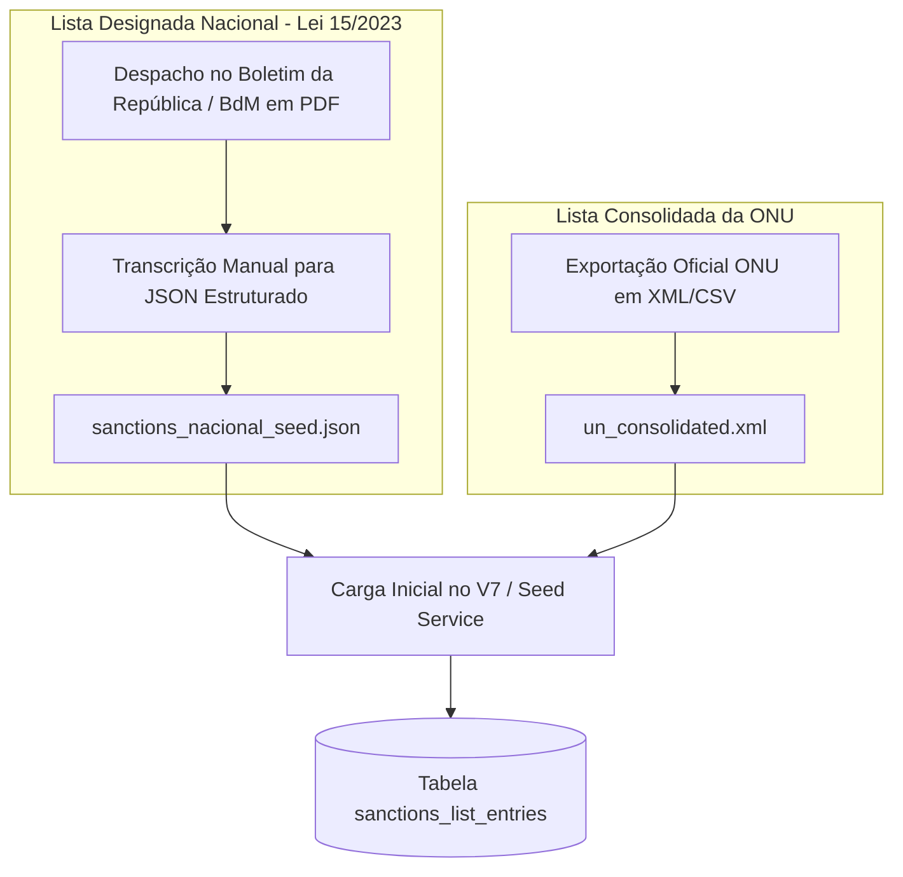

# Fincomp — Plano de Execução Detalhado (25 a 28 Dias para MVP Regulatório)

> **Arquivo histórico — terminologia atualizada:** Este plano descreve uma fase anterior do Fincomp. A nomenclatura corrente é **Financial Compliance Intelligent**; os componentes atuais são `package/grc-engine` e `app/design-system`. Consulte `ROADMAP.md` e `fincomp-workspace.yaml` para o estado vigente.

Plano operacional e técnico calibrado para a implementação do **Fincomp (v2)**, ferramenta de auditoria e compliance AML-CFT para instituições de microfinanças e microcrédito em Moçambique.

Base regulatória estrita:
- **Lei n.º 14/2023** (Prevenção e Combate ao Branqueamento de Capitais e Financiamento do Terrorismo)
- **Aviso n.º 10/GBM/2024** (Directrizes Operacionais do Banco de Moçambique — 154 artigos, Cap. XIII)
- **Lei n.º 15/2023** (Regime de Prevenção e Combate ao Terrorismo e Proliferação de Armas de Destruição em Massa)
- **Decreto n.º 53/2023** (Regulamento de Identificação e Diligência de Clientes)

---

## 1. Princípios e Diretrizes Estratégicas

1. **Defensabilidade Regulatória Real**: Cada regra, cálculo de retenção e fluxo operacional implementa estritamente artigos e prazos do quadro legal moçambicano.
2. **Ritmo Calibrado (25–28 Dias Corridos)**: O cronograma foi expandido para acomodar com rigor técnico a arquitetura completa — sem comprimir Redis, 2FA/TOTP com encriptação em repouso, RBAC estrito, motor de sanções e parsers de planilhas complexas.
3. **Ingestão Baseada em Dados Reais**: Manutenção simultânea de parsers CSV (OpenCSV) e XLSX (Apache POI). Antes da finalização do módulo de ingestão, serão recolhidos exports reais anonimizados dos dois clientes piloto para tratar cabeçalhos deslocados, rodapés e células fundidas.
4. **Tratamento Específico de Listas de Sanções**:
   - **Lista Designada Nacional (Lei 15/2023)**: Não existe exportação oficial em formato estruturado (CSV/JSON). O GIFiM e a PGR publicam-na exclusivamente em PDF via Despacho no Boletim da República. Antes da codificação do seed, os dados da versão mais recente são transcritos manualmente para um arquivo estruturado.
   - **Lista Consolidada da ONU**: Ingestão direta via exportação oficial em XML/CSV.
5. **Separação Rígida de Conceitos Legais**:
   - **STR (Art. 98)**: Juízo de suspeita humana pelo OCOS, reporte com formulário legal formal ao GIFiM.
   - **CTR (Art. 44 / Art. 129)**: Comunicação automática por limiar de valor ou agregação mensal.
   - **SLA de 24h para Sanções (Lei 15/2023, Art. 38-40)**: Prioridade operacional máxima e congelamento imediato.

---

## 2. Visão Geral do Cronograma (25 a 28 Dias)

```mermaid
gantt
    title Fincomp — Cronograma de Execução Calibrado (28 Dias)
    dateFormat  YYYY-MM-DD
    axisFormat  Dia %d
    section Bloco 1: Infra & Banco
    Dias 1-3 : Setup, Docker, Entidades & Flyway V1-V12 :active, b1, 2026-09-07, 3d
    section Bloco 2: Segurança & Auth
    Dias 4-6 : JWT, 2FA/TOTP, Replay Cache & RBAC        :b2, after b1, 3d
    section Bloco 3: Ingestão de Dados
    Dias 7-10 : Amostras Reais, Parsers CSV/XLSX & Mapeamento :b3, after b2, 4d
    section Bloco 4: Motor de Compliance
    Dias 11-13 : KYC, Regime Simplificado (Art.137) & PEP :b4, after b3, 3d
    section Bloco 5: Monitorização & Regras
    Dias 14-16 : Limiares (Art.44) & Fraccionamento (Art.82) :b5, after b4, 3d
    section Bloco 6: Sanções & Auditoria
    Dias 17-19 : Sanções (PDF Nacional + ONU), SLA 24h & Audit :b6, after b5, 3d
    section Bloco 7: Relatórios & Insights
    Dias 20-22 : STR (Art.98), CTR & Insights com Cache Redis :b7, after b6, 3d
    section Bloco 8: Design System Next.js
    Dias 23-26 : Shell shadcn/ui, Upload, Sheets & Relatórios :b8, after b7, 4d
    section Bloco 9: Deploy & Go-Live
    Dias 27-28 : Settings, Deploy EC2, Caddy TLS & Homologação :b9, after b8, 2d
```

---

## 3. Detalhamento Operacional por Blocos de Trabalho

### Bloco 1: Infraestrutura de Desenvolvimento e Modelo de Dados (Dias 1 a 3)
- **Objetivo**: Estabelecer a infraestrutura conteinerizada local, esqueleto Spring Boot 3.3+ (Java 21) e todas as migrações Flyway `V1` a `V12`.
- **Atividades**:
  1. Configurar `docker-compose.yml` local com PostgreSQL 16 (`uuid-ossp`) e Redis 7 Alpine.
  2. Inicializar Spring Boot com: `spring-boot-starter-data-jpa`, `spring-boot-starter-security`, `spring-boot-starter-data-redis`, `flyway-core`, `flyway-database-postgresql`, `zxing`, `commons-codec`, `apache-poi` e `opencsv`.
  3. Criar e versionar as migrações Flyway em `package/grc-engine/src/main/resources/db/migration/`:
     - `V1__init_users.sql`: Utilizadores, RBAC (`ADMIN`, `COMPLIANCE_OFFICER`, `OCOS`, `AUDITOR_READONLY`), campos MFA com segredo criptografado e hashes de códigos de backup.
     - `V2__init_clients.sql`: Clientes, campos `due_diligence_regime` (`NORMAL`/`SIMPLIFIED`), `nuib`, flags PEP e datas de controle.
     - `V3__init_beneficial_owners.sql`: Beneficiários efetivos com papéis legais e limiar ≥10% (Art. 51.1.e).
     - `V4__init_import_batches.sql`: Controle de lotes de ingestão e histórico de mapeamentos.
     - `V5__init_transactions.sql`: Transações financeiras com coluna `retention_until` pré-calculada (= `transaction_date + INTERVAL '10 years'`).
     - `V6__init_threshold_rules.sql`: Regras de limiar com base legal e janelas de agregação.
     - `V7__init_sanctions_list.sql`: Estrutura para Lista Designada Nacional e listas da ONU.
     - `V8__init_flags.sql`: Flags de monitoramento com `sla_deadline` (24h para sanções).
     - `V9__init_str.sql`: Participações de Operações Suspeitas (campos exatos do Art. 98 do Aviso 10).
     - `V10__init_ctr.sql`: Comunicações de transações em espécie/limiar (Art. 44 / 129).
     - `V11__init_audit_log.sql`: Trilha de auditoria append-only; trigger no PostgreSQL que bloqueia `UPDATE` e `DELETE`.
     - `V12__init_system_config.sql`: Configurações do sistema em chave-valor JSONB.
  4. Mapear entidades JPA correspondentes e repositórios Spring Data.
- **Critério de Aceitação (DoD)**: Contêineres sobem sem erros; migrações Flyway aplicadas em banco limpo; teste de tentativa de mutação em `audit_log` rejeitado pelo banco.

---

### Bloco 2: Autenticação Corporativa, RBAC e 2FA/TOTP com Redis (Dias 4 a 6)
- **Objetivo**: Implementar camada de autenticação corporativa segura com suporte a MFA obrigatório para perfis privilegiados (`ADMIN`, `OCOS`) e proteção contra ataques de força bruta.
- **Atividades**:
  1. **Criptografia em Repouso**:
     - Implementar `EncryptionService` (AES-256-GCM com salt e IV) para proteção dos segredos TOTP (`mfa_secret_encrypted`).
     - Configurar `BCryptPasswordEncoder` para senhas e hashes dos códigos de backup.
  2. **Serviços MFA / TOTP (RFC 6238)**:
     - `MfaEnrollmentService`: Geração de segredo Base32, URL `otpauth://` e renderização de QR Code via ZXing. Armazenamento efêmero no Redis (TTL de 10 min).
     - `MfaVerificationService`: Validação com janela de tolerância de 30s.
     - Prevenção de replay attacks: registro do código utilizado no Redis por 60s (`totp_used:{userId}:{code}`).
     - Geração de 8 códigos de recuperação de uso único (armazenados exclusivamente como hashes).
  3. **Fluxo de Login em Dois Passos**:
     - `POST /api/auth/login`: Verificação de credenciais; caso MFA esteja ativo, emissão de `mfaChallengeToken` de 5 min no Redis.
     - `POST /api/auth/mfa/verify`: Validação do código TOTP e emissão do JWT + Refresh Token.
  4. **Proteção e Rate Limiting no Redis**:
     - Bloqueio temporário (15 minutos) após 5 tentativas falhadas (`login_attempts:{email}:{ip}`).
     - Revogação instantânea de sessões e logout via lista de revogação no Redis (`token_blacklist:{jti}`).
- **Critério de Aceitação (DoD)**: Testes de integração cobrindo o ciclo completo de login sem MFA, enrollment com validação do QR Code, login em dois passos, bloqueio por brute-force e bloqueio de replay do mesmo código TOTP.

---

### Bloco 3: Ingestão de Dados Resiliente com Amostras Reais dos Clientes (Dias 7 a 10)
- **Objetivo**: Construir parsers robustos suportando CSV e XLSX, validando-os diretamente contra arquivos reais anonimizados dos dois clientes piloto (microfinança e microcrédito).
- **Atividades**:
  1. **Coleta e Análise de Amostras Reais (Etapa Prévia)**:
     - Solicitar aos dois clientes extratos reais anonimizados do software legador/core banking.
     - Mapear anomalias típicas: cabeçalhos deslocados (linhas de título nas primeiras linhas), linhas de rodapé com somatórios, formatos de datas heterogêneos (`DD/MM/YYYY`, `DD-MM-YYYY`) e células fundidas em Excel.
  2. **Implementação dos Parsers**:
     - `CsvParser` (via OpenCSV): Detecção automática de separador (`;`, `,`, `\t`), suporte a UTF-8 e ISO-8859-1, streaming linha a linha.
     - `XlsxParser` (via Apache POI): Leitura orientada a streaming (SXSSF/EventModel para baixo consumo de memória), resolução de valores de células fundidas e sanitização de fórmulas.
  3. **Motor de Mapeamento Dinâmico de Colunas**:
     - Heurística inicial para sugerir associações de colunas obrigatórias: Documento (BI/NUIT), Nome, Data da Operação, Montante, Tipo de Operação, Conta.
     - Endpoint `POST /api/import-batches/{id}/confirm-mapping` com processamento transacional.
  4. **Normalização e Vínculo com Clientes**:
     - Criação/vinculação idempotente de clientes por documento.
     - Cálculo imediato de retenção legal da transação: `retention_until = transaction_date + 10 years` (Art. 88 do Aviso 10).
     - Persistência estruturada de linhas com erro em JSONB para auditoria do operador.
- **Critério de Aceitação (DoD)**: Ingestão bem-sucedida de amostras reais das duas instituições, tratando rodapés e cabeçalhos deslocados sem interrupção do processo.

---

### Bloco 4: Motor de Compliance — KYC, Regime Simplificado & PEP (Dias 11 a 13)
- **Objetivo**: Implementar as regras centrais de diligência do Capítulo XIII do Aviso 10/GBM/2024 e o regime contínuo de PEP.
- **Atividades**:
  1. **Regime de Diligência Simplificado para Microfinanças (Artigos 134–141)**:
     - `DueDiligenceRegimeValidator`:
       - Validação dos limites estritos: limite mensal de **30.000 MT** e anual de **240.000 MT** (Artigo 137).
       - Registro obrigatório do NUIB (Artigo 138).
       - Mecanismo de transição automática: se o cliente exceder 30.000 MT no mês corrente, o sistema gera flag de quebra de regime e força transição para `NORMAL`.
  2. **Diligência Normal e Beneficiários Efetivos**:
     - Identificação de beneficiários efetivos com participação ≥10% (Artigo 51.1.e) e papéis legais (Artigo 36.3).
     - Avaliação de completude de KYC e sinalização de pendências documentais.
  3. **Pessoas Politicamente Expostas (Artigos 65–66)**:
     - `PepScreeningService`:
       - Trava de aprovação da direção de topo (`senior_management_approved`) prévia ao relacionamento.
       - Job agendado que monitora `pep_last_reviewed_at`: se o intervalo ultrapassar 12 meses (365 dias), gera flag automática `PEP_REVIEW_DUE`.
- **Critério de Aceitação (DoD)**: Testes de unidade e integração comprovando que excessos de limite no regime simplificado disparam alertas e que clientes PEP com revisão vencida entram na fila de compliance.

---

### Bloco 5: Motor de Monitorização — Limiares e Detecção de Fraccionamento (Dias 14 a 16)
- **Objetivo**: Implementar as regras de detecção de operações relevantes por limiar e identificação de fraccionamento de transações (structuring).
- **Atividades**:
  1. **Regras de Limiar Único**:
     - Avaliação automática de cada transação contra as regras ativas de `threshold_rules` (Artigo 44(3) da Lei 14/2023).
     - Geração de flag `THRESHOLD_VALUE` e minuta de CTR.
  2. **Detecção de Fraccionamento / Structuring (Artigo 82 do Aviso 10/GBM/2024)**:
     - `StructuringDetectionService`:
       - Consulta com agrupamento por cliente em janela deslizante de 30 dias (Artigo 129.2).
       - Detecção de padrões de depósitos/operações fragmentadas que individualmente não atingem o limiar, mas que somadas o superam no mês.
       - Geração de flag `STRUCTURING_SUSPECTED` com agregação detalhada das transações envolvidas.
- **Critério de Aceitação (DoD)**: Algoritmo identifica com precisão múltiplos lançamentos fracionados de um mesmo cliente dentro da janela de 30 dias, gerando flag com a listagem das evidências.

---

### Bloco 6: Sanções (Lei 15/2023), SLA Crítico de 24h e Trilha de Auditoria (Dias 17 a 19)
- **Objetivo**: Implementar o motor de sanções antiterrorismo com o SLA legal de congelamento em 24h e consolidar a base estruturada de dados.
- **Atividades**:
  1. **Preparação Estruturada da Lista de Sanções**:
     - **Lista Designada Nacional**: Transcrição manual a partir do PDF publicado no Boletim da República / Banco de Moçambique para arquivo estruturado (`sanctions_nacional_seed.json`).
     - **Lista Consolidada da ONU**: Ingestão direta via exportação oficial XML/CSV (`un_consolidated.xml`).
     - Carga estática inicial executada na inicialização do sistema.
  2. **Motor de Triagem de Sanções**:
     - `SanctionsScreeningService`: Comparação aproximada de nomes (normalização de caracteres especiais, Levenshtein e Jaro-Winkler).
     - Em caso de match:
       - Flag imediata `SANCTIONS_MATCH`.
       - Definição estrita de `sla_deadline = now() + 24 HOURS` conforme os Artigos 38–40 da Lei 15/2023.
       - Marcação do cliente para bloqueio/congelamento preventivo de ativos.
  3. **Gestão Operacional de Flags & Auditoria**:
     - Fila de revisão (`FlagService`) ordenada pelo vencimento do SLA de 24h.
     - Justificativa obrigatória do auditor em cada resolução de flag.
     - `AuditService`: registro de todos os eventos de mutação em `audit_log` (append-only).
- **Critério de Aceitação (DoD)**: Triagem contra sanções gera alerta com prazo fatal de 24 horas; lista nacional transcrita e lista da ONU importadas com sucesso; tentativas de alteração em auditoria bloqueadas.

---

### Bloco 7: Relatórios Regulatórios (STR e CTR) e Insights com Redis Cache (Dias 20 a 22)
- **Objetivo**: Disponibilizar a geração formal dos relatórios para o GIFiM e os indicadores analíticos do dashboard com alta performance.
- **Atividades**:
  1. **Participação de Operação Suspeita (STR — Artigo 98)**:
     - `StrReportService`: Fluxo de escalamento de flag para STR pelo OCOS.
     - Validação dos campos obrigatórios do Art. 98: entidade comunicante, número de conta, titular, executor, descrição circunstanciada da suspeita, vínculo interno, declaração voluntária e identificação do OCOS.
     - Exportação em PDF formal padronizado.
     - Registro de submissão com número GIFiM e retenção fixada em 10 anos (`submitted_at + 10 years`).
  2. **Comunicação Automática de Transações (CTR — Artigos 44 e 129)**:
     - `CtrReportService`: Consolidação de transações acima do limiar no período mensal e exportação de pacote de comunicação.
  3. **Insights e Métricas com Cache Redis**:
     - Agregações de risco: taxa de completude KYC, clientes sob regime simplificado, flags com SLA crítico, revisões PEP pendentes.
     - Cache via `@Cacheable` no Redis com TTL de 5 minutos e invalidação na importação de novos lotes.
- **Critério de Aceitação (DoD)**: Emissão de PDF de STR preenchendo todos os requisitos legais do Art. 98; consultas de dashboard respondendo em menos de 50ms via cache Redis.

---

### Bloco 8: Design System Next.js — Shell shadcn/ui, Mapeamento, Dossiês e Relatórios (Dias 23 a 26)
- **Objetivo**: Desenvolver interface SPA baseada em Next.js (App Router) e shadcn/ui, proporcionando fluidez operacional em tela única com `Sheet` e `Dialog`.
- **Atividades**:
  1. **Shell e Autenticação**:
     - Layout persistente com `AppSidebar` e `SiteHeader`.
     - Telas de Login, tela de desafio MFA (código de 6 dígitos com suporte a fallback de códigos de backup) e Dialog de enrollment com exibição do QR Code.
  2. **Ingestão e Mapeamento de Planilhas**:
     - Interface de upload com drag-and-drop.
     - Dialog interativo para confirmação de mapeamento de colunas com visualização prévia de linhas das amostras reais.
  3. **Fila de Flags e Tratamento de Sanções**:
     - Tabela dinâmica de flags com ordenação prioritária por prazo de SLA.
     - Badge visual pulsante para alertas de sanções da Lei 15/2023 com contagem decrescente (ex: `SLA: 14h restantes`).
     - `FlagReviewSheet.tsx`: Análise do histórico da transação, registro de justificativa e botão de escalamento para STR.
  4. **Dossiê de Clientes e Relatórios**:
     - Tabela de clientes com filtros por regime (Normal/Simplificado), risco e PEP.
     - `ClientDetailSheet.tsx`: Visualização de beneficiários efetivos, NUIB e histórico de operações.
     - Telas de emissão de STR/CTR com formulários validados via Zod e download de PDF.
- **Critério de Aceitação (DoD)**: Operações de ponta a ponta (login com 2FA, upload de arquivo real, revisão de flag na Sheet lateral e geração de STR) executadas sem erros no design system.

---

### Bloco 9: Configurações, Hardening, Deploy em AWS EC2 e Validação Final (Dias 27 a 28)
- **Objetivo**: Configurar o módulo administrativo de parametrização, executar o deploy em produção single-tenant (EC2 `t4g.small`) com Caddy e validar com dados das instituições piloto.
- **Atividades**:
  1. **Configurações e Gestão de Utilizadores (RBAC)**:
     - Interface restrita ao `ADMIN` para gestão de contas, perfis e redefinição de MFA.
     - Ajuste de parâmetros legais (limites de 30.000 MT / 240.000 MT e limiares de transação).
  2. **Deploy EC2 e Orquestração Docker**:
     - `docker-compose.prod.yml` com os 5 contêineres: `app` (Spring Boot ARM64), `design system` (Next.js standalone), `db` (PostgreSQL 16), `redis` (Redis 7 AOF com senha) e `caddy`.
     - Configuração do `Caddyfile` com TLS automático (Let's Encrypt), proxy reverso e cabeçalhos de segurança (HSTS, CSP, X-Frame-Options).
  3. **Backup e Contingência**:
     - Script cron diário de `pg_dump` criptografado para bucket S3 com Object Lock.
  4. **Homologação com Dados Reais**:
     - Carga de validação com os extratos das instituições piloto e homologação final com o OCOS.
- **Critério de Aceitação (DoD)**: Instância online em produção sob HTTPS; todos os serviços saudáveis; backup automático validado; entrega formal ao cliente.

---

## 4. Matriz de Perfis e Permissões (RBAC)

| Funcionalidade / Operação | ADMIN | COMPLIANCE_OFFICER | OCOS | AUDITOR_READONLY |
|---|:---:|:---:|:---:|:---:|
| 2FA/TOTP Obrigatório | **Sim** | Recomendado | **Sim** | Opcional |
| Gestão de Contas de Utilizador | **Sim** | Não | Não | Não |
| Alteração de Regras de Limiares | **Sim** | Não | **Sim** | Não |
| Ingestão de Ficheiros (CSV/XLSX) | **Sim** | **Sim** | **Sim** | Não |
| Triagem e Resolução de Flags | Não | **Sim** | **Sim** | Não |
| Escalamento e Assinatura de STR (Art. 98) | Não | Não | **Sim** | Não |
| Submissão de CTR ao GIFiM | Não | Não | **Sim** | Não |
| Visualização de Dossiês de Clientes e PEP | **Sim** | **Sim** | **Sim** | **Sim** |
| Consulta a Registos de Auditoria (`audit_log`) | **Sim** | Não | **Sim** | **Sim** |

---

## 5. Estratégia de Carga das Listas de Sanções

Devido às especificidades da administração pública em Moçambique, a carga de listas restritivas adota dois fluxos distintos:



- **Lista Designada Nacional**: A cada publicação de novo Despacho no Boletim da República, o responsável de compliance atualiza o arquivo estruturado para re-seed.
- **Lista da ONU**: Arquivo oficial importado diretamente via script de carga.

---

## 6. Próximos Passos Imediatos para Início do Bloco 1

1. Subir a infraestrutura base local com Docker Compose (PostgreSQL 16 e Redis 7).
2. Gerar o scaffold Spring Boot com o conjunto completo de dependências (OpenCSV, Apache POI, ZXing, JJWT, Flyway).
3. Solicitar aos dois clientes piloto as amostras reais anonimizadas de extratos para antecipar a calibração dos parsers antes do Bloco 3.
4. Realizar a transcrição manual do PDF vigente da Lista Designada Nacional para o arquivo de seed inicial.
